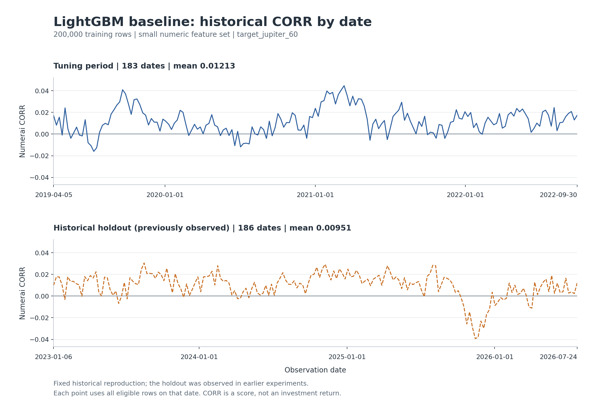
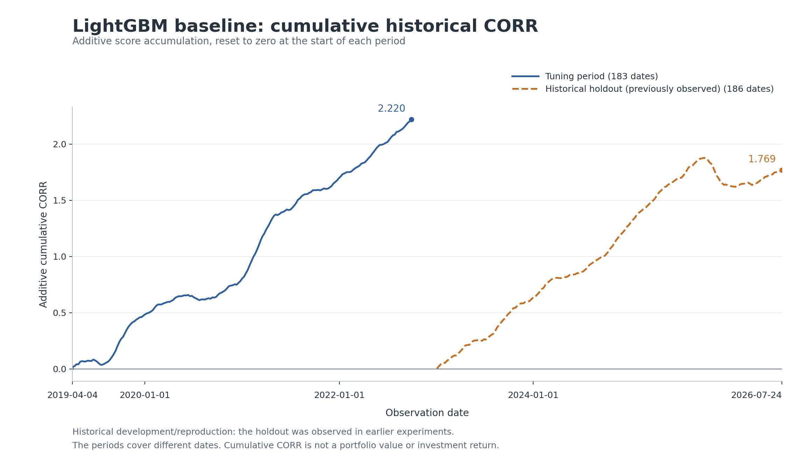

# Xinchen Geng — Baseline & Validation

This contribution implements Xinchen Geng's responsibilities in the project proposal (Part 5): the official small-feature LightGBM baseline, time-based validation, and historical Numerai CORR scoring. It provides the baseline evidence for the team's later model comparisons.

## Requirements and implementation

| Proposal requirement | Implementation and evidence |
| --- | --- |
| Reproduce the official small-feature baseline (Part 3) | `scripts/run_xinchen_baseline.py`; 100 numeric small features, 200,000 sampled training rows, seed 7; pinned official tutorial in `references/` |
| Validate chronologically with at least 60 business days of separation (Part 3) | `scripts/prepare_data.py`; strict 65-weekday embargo, with 70 weekdays between the retained boundary dates |
| Exclude rows with missing targets (Part 3) | Cleaning filters for mature `target_jupiter_60` labels and eligible historical `data_type` values |
| Report historical CORR, date-level mean/std, trends, and runtime (Part 4) | `results/xinchen_baseline_20261030/`; summary and per-date CSVs, run/protocol JSON, and two CORR figures |

The baseline uses 300 trees, learning rate 0.05, maximum depth 5, 31 leaves, and column sampling 0.1. Parameters are fixed before evaluation; this entry point does not tune, select, or refit models using validation results. CORR is the primary metric requested by the proposal. NCORR is reported separately using the official neutralizers.

## Recorded historical results

The completed run is dated 2026-10-30. Training draws 200,000 rows from 4,329,443 eligible training records spanning 2003-01-03 through 2018-12-28.

| Evaluation period | Date range | Dates | Rows | CORR mean | CORR std (ddof=0) | NCORR mean |
| --- | --- | ---: | ---: | ---: | ---: | ---: |
| Tuning period | 2019-04-05 to 2022-09-30 | 183 | 1,211,007 | 0.012133 | 0.011770 | 0.013674 |
| Historical holdout, previously observed | 2023-01-06 to 2026-07-24 | 186 | 1,254,407 | 0.009509 | 0.011799 | 0.010118 |

All summary scores give equal weight to each observation date. The historical holdout had already been observed in earlier project experiments; these results support historical reproduction and development, and do not establish performance on a new unseen test set or in live rounds.

The original run took 177.18 seconds including input hashing and scoring; model fitting took 1.17 seconds. Peak process memory was approximately 4.07 GiB. These measurements depend on hardware.

- [Full summary metrics](results/xinchen_baseline_20261030/metrics.csv)
- [Scores for all 369 dates](results/xinchen_baseline_20261030/per_date_metrics.csv)
- [Frozen protocol](results/xinchen_baseline_20261030/protocol.json), [run and hashes](results/xinchen_baseline_20261030/run.json), and [recorded independent validation](results/xinchen_baseline_20261030/validation.json)
- [Data provenance](results/xinchen_baseline_20261030/data_provenance/): original download manifest, feature metadata, cleaning report, split manifest, and date counts

The recorded independent audit recomputed CORR for all 2,465,414 predictions, rebuilt the training sample, checked split boundaries and hashes, and verified one full holdout date against the saved model and an independent NCORR calculation. The maximum CORR error was approximately `9.97e-17`.





Cumulative CORR is an additive score diagnostic, reset at the start of each period. It is not an investment return.

## Reproduce

Run these commands from this `XinchenGeng/` directory. The recorded environment used Python 3.13.7; dependencies are pinned in `requirements.txt`. Public data downloads require no account or API key. The original raw download was approximately 8.24 GB, and additional space is needed for processed files and generated results.

```powershell
cd XinchenGeng
python -m venv .venv
.\.venv\Scripts\python.exe -m pip install -r requirements.txt
.\.venv\Scripts\python.exe scripts/download_data.py
.\.venv\Scripts\python.exe scripts/prepare_data.py
.\.venv\Scripts\python.exe -m unittest discover -s tests -v
.\.venv\Scripts\python.exe scripts/run_xinchen_baseline.py --output results/xinchen_baseline_reproduction
.\.venv\Scripts\python.exe scripts/validate_xinchen_baseline.py --output results/xinchen_baseline_reproduction
.\.venv\Scripts\python.exe scripts/plot_xinchen_baseline.py --output results/xinchen_baseline_reproduction
```

The initial `cd XinchenGeng` assumes you start at the repository root; omit it if already inside this directory. On macOS/Linux, use `.venv/bin/python` in place of `.\.venv\Scripts\python.exe`.

Use the same fresh `--output` directory for training, validation, and plotting. The trainer refuses to overwrite a nonempty directory, including the committed historical results. Raw datasets, trained models, and row-level prediction Parquet files are generated locally and excluded from Git. To run the full audit, first generate the model and predictions with the training command above; the committed `validation.json` records the original local audit.

The Numerai download endpoint supplies currently available files. Exact reproduction of the archived hashes requires the original data snapshot; a later download may reproduce the workflow with different input hashes or dates. Original manifests are preserved in `data_provenance/` for comparison. `.gitattributes` preserves byte-level hashes across Git checkouts, and the validator accepts manifest paths written on Windows or Unix.

## Files and scope

- `scripts/run_xinchen_baseline.py`: fixed baseline training and historical scoring.
- `scripts/validate_xinchen_baseline.py`: independent CORR/NCORR checks, sample reconstruction, and provenance audit.
- `scripts/plot_xinchen_baseline.py`: the two historical CORR figures.
- `scripts/download_data.py` and `scripts/prepare_data.py`: public data retrieval and shared chronological preparation.
- `scripts/run_experiments.py`: unchanged shared helper module imported by the baseline; its source hash is retained in the original run. Its separate multi-model pilot entry point is outside this contribution and is not called by the reproduction commands.
- `tests/`: 10 existing tests for cleaning, embargo boundaries, scoring, alignment, and score summaries.
- `references/`: pinned official example notebook, source records, and the notebook's MIT license.

Shared preparation records contain fields for the team's auxiliary target, medium features, and tuning-based selection policy. This baseline reads only small numeric features and `target_jupiter_60`; it performs no model selection. The baseline-specific policy is recorded in `protocol.json`.

Other members' improved models, ensemble experiments, paper optimization results, live submissions, and account credentials are outside this upload.
